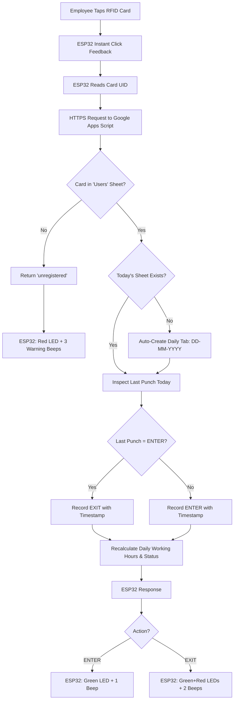

# ESP32 RFID Attendance System 🕒📋

> A lightweight, serverless IoT attendance tracking system powered by an **ESP32**, **RC522 RFID reader**, and **Google Sheets**. Every scan logs real-time timestamps with automatic daily sheet generation, intelligent Enter/Exit toggle, and an automated **Daily Working Hours & Attendance Summary** table.

---

## 🌟 Why This is the Simplest Architecture to Build

Unlike traditional attendance systems that require dedicated servers, MySQL/Postgres databases, complex authentication tokens, or paid cloud subscriptions:

1. **Zero Database Maintenance**: Google Sheets acts as your cloud database and live UI simultaneously.
2. **Native Excel Spreadsheet**: View scans live on desktop or mobile, and export to `.xlsx` or `.csv` in one click.
3. **Automatic Daily Sheet Generation**: The backend automatically detects the date and creates a clean new sheet tab (e.g., `07-11-2026`, `08-11-2026`) on the first punch of each day.
4. **Smart Enter/Exit Detection**: Automatically toggles between `ENTER` and `EXIT` based on each employee's history for the day.
5. **Automated Daily Working Hours Summary**: Automatically calculates:
   * **Total Entries** (count of `ENTER`)
   * **Total Exits** (count of `EXIT`)
   * **Total Time Inside / Working Hours** (sums duration between all check-ins and check-outs)
   * **Live Status** (`🟢 Currently Inside`, `Checked Out`, or `Absent`)
6. **Ultra-Low Cost & Fast**: Built on standard, readily available hardware (ESP32 + RC522 + LEDs + Buzzer).

---

## 📊 Daily Sheet Structure

Each daily tab contains **two distinct sections**:

### 1. Raw Punch Logs (Top Table)
| Time | Card_UID | Name | ID_Number | Action |
|---|---|---|---|:---:|
| `09:02:15` | `B3 A1 29 4F` | John Doe | EMP-001 | `ENTER` |
| `13:00:10` | `B3 A1 29 4F` | John Doe | EMP-001 | `EXIT` |
| `14:00:25` | `B3 A1 29 4F` | John Doe | EMP-001 | `ENTER` |
| `18:05:40` | `B3 A1 29 4F` | John Doe | EMP-001 | `EXIT` |

### 2. Daily Attendance & Working Hours Summary (Below Logs)
| Employee Name | ID Number | Total Entries | Total Exits | Total Working Hours | Status |
|---|:---:|:---:|:---:|:---:|:---:|
| **John Doe** | EMP-001 | **2** | **2** | **8h 03m 10s** | Checked Out |
| **Jane Smith** | EMP-002 | **1** | **0** | **4h 12m 00s (Active)** | 🟢 Currently Inside |

* **Working Hours Calculation**: The system matches every `ENTER` with its corresponding `EXIT` and sums up the exact seconds spent inside the office, accounting for lunch breaks and multiple check-outs!

---

## ⚙️ How the System Works



---

## 🔔 LED & Buzzer Indicator Guide

| Event | Green LED (GPIO 2) | Red LED (GPIO 4) | Buzzer (GPIO 15) | Meaning / Status |
|---|:---:|:---:|:---:|---|
| **Instant Tap** | ⚡ Quick Flash | OFF | 1 Short Click (60ms) | Card detected; transmitting to cloud |
| **Check-In (ENTER)** | 🟢 Solid ON (400ms) | OFF | 1 Solid Beep (400ms) | Entry logged successfully |
| **Check-Out (EXIT)** | 🟢 Double Blink | 🔴 Double Blink | 2 Quick Beeps | Exit logged successfully |
| **Unregistered Card** | OFF | 🔴 Triple Blink | 3 Warning Beeps | Card UID not found in `Users` tab |
| **Connection Error** | OFF | 🔴 Solid ON (600ms) | 1 Long Buzz (600ms) | Wi-Fi lost or server request timeout |

---

## 🔌 Hardware Wiring Diagram

### 1. RFID RC522 Module
| RC522 Pin | ESP32 GPIO Pin | Description |
|---|---|---|
| **VCC (3.3V)** | **3V3** | Power (Do NOT connect to 5V!) |
| **RST** | **GPIO 22** | Reset Pin |
| **GND** | **GND** | Ground |
| **MISO** | **GPIO 19** | SPI Master In Slave Out |
| **MOSI** | **GPIO 23** | SPI Master Out Slave In |
| **SCK** | **GPIO 18** | SPI Clock |
| **SDA (SS)** | **GPIO 5** | SPI Slave Select |

### 2. Indicators (LEDs & Buzzer)
| Component | ESP32 GPIO Pin | Notes |
|---|---|---|
| **Green LED (+)** | **GPIO 2** | Use 220Ω - 330Ω resistor to GND |
| **Red LED (+)** | **GPIO 4** | Use 220Ω - 330Ω resistor to GND |
| **Active Buzzer (+)** | **GPIO 15** | Connect (-) to GND |

---

## 📂 Project Repository Structure

```text
esp32-rfid-attendance/
├── README.md
├── LICENSE
├── .gitignore
├── template/
│   └── Attendance_System_Template.xlsx    # Starter workbook with daily logs & summary
└── code/
    ├── Attendance_ESP32/
    │   └── Attendance_ESP32.ino           # ESP32 C++ firmware (Wi-Fi + RC522 + HTTPS)
    └── GoogleAppsScript/
        └── Code.gs                        # Automated daily sheet, punch toggle & summary backend
```

---

## 🚀 Setup & Installation Guide

### Step 1: Set Up the Google Sheet
1. Upload [`template/Attendance_System_Template.xlsx`](template/Attendance_System_Template.xlsx) to your [Google Drive](https://drive.google.com).
2. Right-click the uploaded file $\rightarrow$ **Open with Google Sheets**.
3. Go to **File** $\rightarrow$ **Save as Google Sheets**.
4. The spreadsheet contains a master tab named **`Users`**:
   * `Card_UID`: Scanned hex format (e.g., `B3 A1 29 4F`).
   * `Name`: Employee full name.
   * `ID_Number`: Employee ID / Badge code.

### Step 2: Deploy the Webhook (Google Apps Script)
1. In your Google Sheet, click **Extensions** $\rightarrow$ **Apps Script**.
2. Replace the code with the contents of [`code/GoogleAppsScript/Code.gs`](code/GoogleAppsScript/Code.gs).
3. Click **Save** (disk icon).
4. Click **Deploy** $\rightarrow$ **New deployment** (or **Manage deployments** $\rightarrow$ Edit to **New version**).
5. Set **Who has access**: **`Anyone`**.
6. Click **Deploy** and copy your **Web App URL**.

### Step 3: Flash the ESP32 Code
1. Open [`code/Attendance_ESP32/Attendance_ESP32.ino`](code/Attendance_ESP32/Attendance_ESP32.ino) in the Arduino IDE.
2. Update your Wi-Fi credentials and Google Web App URL:
   ```cpp
   const char* WIFI_SSID        = "YOUR_WIFI_NAME";        
   const char* WIFI_PASSWORD    = "YOUR_WIFI_PASSWORD";    
   const char* GOOGLE_SCRIPT_URL = "YOUR_GOOGLE_SCRIPT_WEB_APP_URL";
   ```
3. Select your ESP32 board and COM port, then click **Upload**.

---

## 👥 Managing Employees

To register or update an employee:
1. Tap a card on the reader and view the Serial Monitor (`115200 baud`) to see the scanned UID (e.g. `B3 A1 29 4F`).
2. Open your Google Sheet $\rightarrow$ **`Users`** tab.
3. Add a new row with the UID, employee's name, and their ID number.
4. Changes take effect immediately—**no redeployment or board restart needed**.

---

## 🔒 Security & Privacy Notice

* Keep your **Wi-Fi credentials** and **Google Script Web App URL** private.
* The Google Sheet itself remains completely private to your Google account; external devices can only invoke the `doGet` endpoint to append attendance logs.

---

## 📄 License
This project is open-source under the [MIT License](LICENSE).
